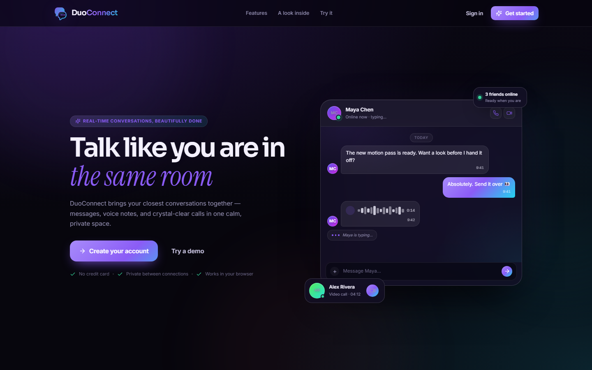
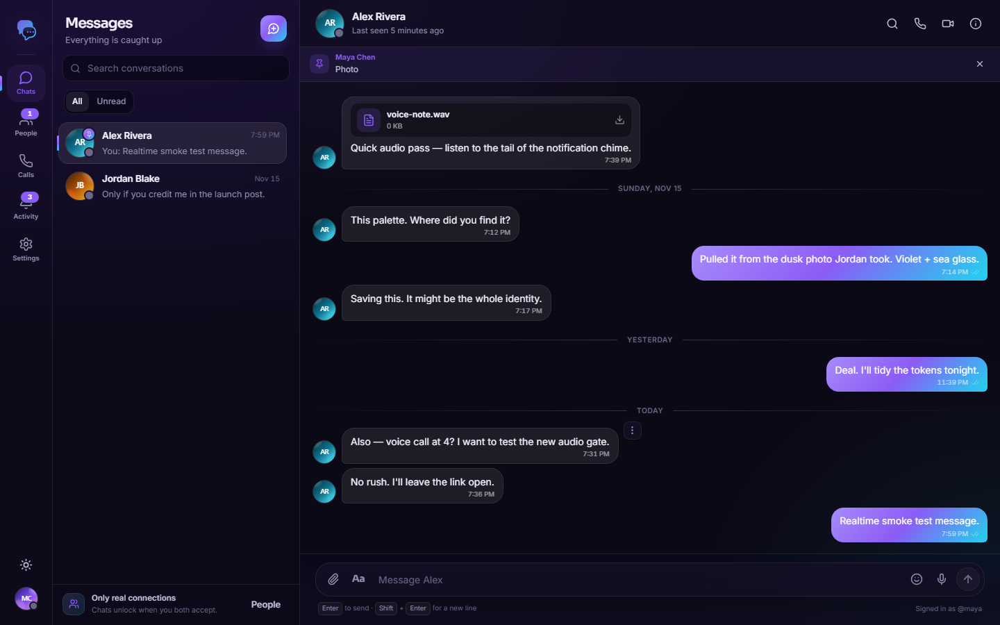
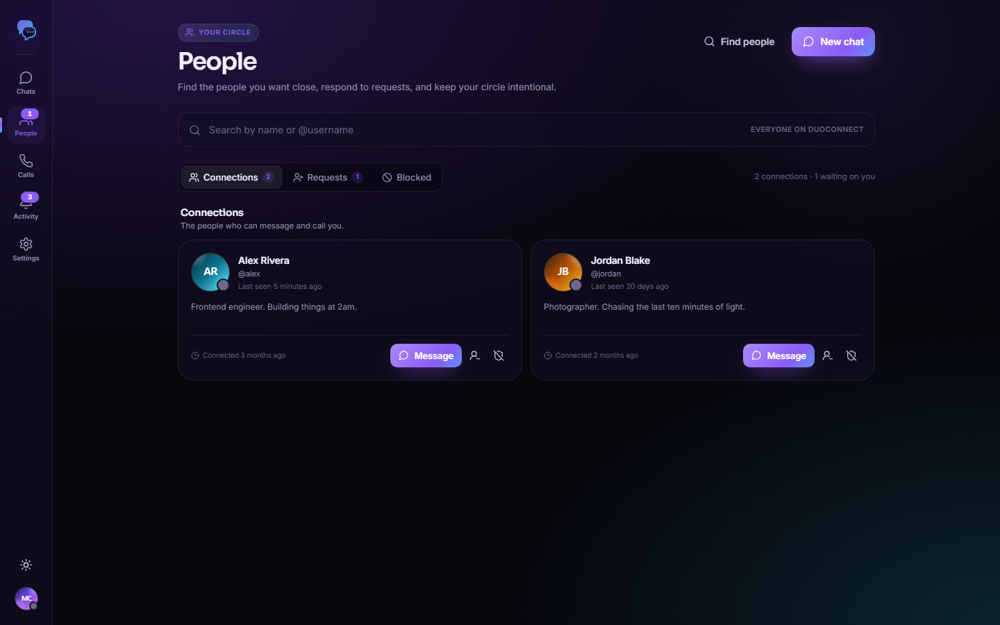
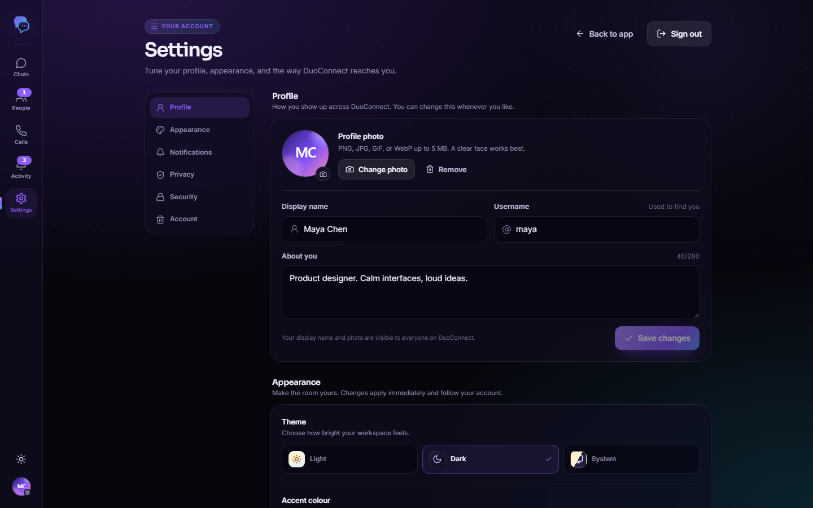
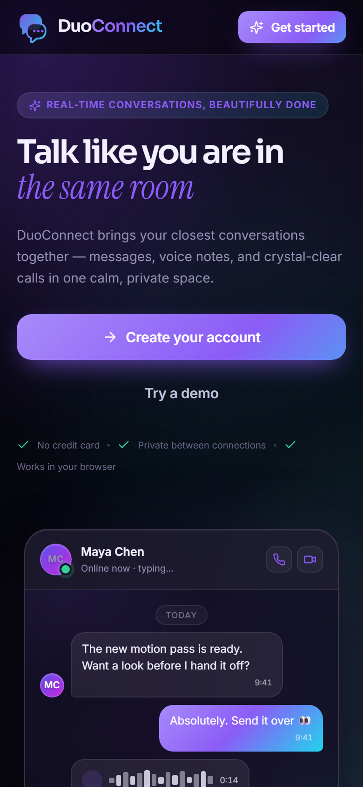

# DuoConnect

A complete real-time communication platform for two people — private chat, presence, friendships, and peer-to-peer voice and video calls.

DuoConnect is built as a portfolio-grade full-stack project: a React 19 single-page app, an Express + Socket.IO API, a normalized Postgres schema that runs on Supabase, and a custom WebRTC call stack with perfect negotiation.

<p align="center">
  <strong>Chat · Presence · Friends · WebRTC calls · Notifications · Settings</strong>
</p>

## What makes it special

- **Zero-config local mode.** Leave `DATABASE_URL` empty and the server starts an embedded PGlite Postgres database and applies migrations. No Docker, no external database, no setup friction.
- **Production-shaped, not a toy.** Layered backend modules, rotating refresh tokens with reuse detection, typed validation on every boundary, rate limiting, secure uploads, and graceful shutdown.
- **Calls that actually work.** A custom `RTCPeerConnection` manager with perfect negotiation, ICE buffering, screen sharing, camera switching, media stats, and connection-quality feedback.
- **A real interface.** Designed from scratch with CSS Modules: glassmorphism, dark/light themes, four accent palettes, four wallpapers, reduced-motion support, responsive layouts, and motion that communicates instead of decorating.

## Screens

| Area          | Highlights                                                                                                                                                  |
| ------------- | ----------------------------------------------------------------------------------------------------------------------------------------------------------- |
| Landing       | Animated split hero: a fixed call window beside a scrolling conversation, feature story, direct sign-up                                                     |
| Auth          | Split story panel, glass form, remembered sessions, inline validation                                                                                       |
| Chats         | Three-column shell, virtualized-ready thread, typing indicators, pins, replies, edits, deletions, attachments, voice notes, infinite scroll, in-chat search |
| People        | Global user search, connection cards, incoming/outgoing requests, blocked list, confirmation flows                                                          |
| Profile       | Presence, shared context, message/call actions, connect/remove/block flows                                                                                  |
| Calls         | Perspective-aware history, filters, duration summaries, one-click callback                                                                                  |
| Notifications | Grouped activity, click-through routing, unread filtering, bulk actions, Web Push for messages and calls when the tab is closed                             |
| Settings      | Profile and avatar, appearance, notification preferences, privacy, password, sessions, account deletion                                                     |

### A look inside

| Landing                                                  | Chat thread                                          |
| -------------------------------------------------------- | ---------------------------------------------------- |
|  |  |

| People                                            | Settings                                              |
| ------------------------------------------------- | ----------------------------------------------------- |
|  |  |

The interface is responsive down to small phones:



## Tech stack

| Layer   | Choices                                                                                                                                              |
| ------- | ---------------------------------------------------------------------------------------------------------------------------------------------------- |
| Client  | React 19, Vite 6, React Router 7, Zustand 5, Axios, Socket.IO Client, CSS Modules, Framer Motion, React Hook Form, React Hot Toast, Lucide, date-fns |
| Server  | Node.js 20+, Express 5, Socket.IO 4, JWT, bcrypt, Multer, Zod, Pino, Helmet, express-rate-limit                                                      |
| Data    | PostgreSQL 15+ / Supabase, or embedded PGlite for local development and tests                                                                        |
| Calls   | Native WebRTC, STUN/TURN configurable via `VITE_ICE_SERVERS`, perfect negotiation                                                                    |
| Tooling | npm workspaces, ESLint 9, Prettier, node:test, Supertest, Vitest, Testing Library, Docker, GitHub Actions                                            |

## Architecture at a glance

```text
client/                      React SPA
  src/lib/                   API, socket, WebRTC, formatting
  src/stores/                Zustand domain stores
  src/hooks/                 Socket bridge, appearance, media queries
  src/components/            UI kit, layout, chat, call, overlays
  src/pages/                 Route-level screens
  src/styles/                Tokens and global base

server/                      Express + Socket.IO
  src/modules/<domain>/      route → controller → service → repository
  src/realtime/              Gateway, presence, chat/call handlers, event bridge
  src/db/                    Adapter and migrations
  src/middleware/            Auth, validation, uploads, rate limits, errors
  src/services/storage.js    Local disk or Cloudinary

docs/                        Product and engineering documentation
scripts/                     Live REST and realtime smoke tests
```

Services never import Socket.IO. They publish domain facts through `realtime/events.js`; the realtime layer decides how to deliver them. That keeps HTTP code testable and leaves a clean seam for a Redis adapter when scaling horizontally.

## Quick start

Requirements: **Node.js 20.19+** and npm 10+.

```bash
git clone <your-repo-url> duoconnect
cd duoconnect
npm install
npm run dev
```

Open <http://localhost:5173>. The API starts on <http://localhost:5000> and migrates the embedded database automatically. Create two accounts to see presence, typing, delivery, read receipts, and calls in real time.

### Using Supabase

```bash
cp server/.env.example server/.env
# Set DATABASE_URL to your Supabase Postgres connection string
npm run migrate
npm run dev
```

See [docs/SETUP.md](docs/SETUP.md) for the full environment reference.

## Scripts

| Command                | What it does                                      |
| ---------------------- | ------------------------------------------------- |
| `npm run dev`          | Run API and Vite client together                  |
| `npm run dev:server`   | API with watch mode                               |
| `npm run dev:client`   | Vite dev server                                   |
| `npm run build`        | Production client build                           |
| `npm start`            | Start the API (serves `client/dist` when present) |
| `npm run migrate`      | Apply SQL migrations                              |
| `npm test`             | Server integration tests + client unit tests      |
| `npm run lint`         | ESLint for both workspaces                        |
| `npm run format`       | Prettier write                                    |
| `npm run format:check` | Prettier check                                    |

Live smoke tests (require a running API):

```bash
node scripts/smoke-rest.mjs
node scripts/smoke-realtime.mjs
```

The REST suite exercises every module (auth, profiles, friends, chats, messages, uploads, notifications, calls, sessions, blocking, deletion) and the realtime suite verifies presence, typing, messages, receipts, and call signaling — including SDP relay.

## Documentation

- [Setup and environment](docs/SETUP.md)
- [Architecture](docs/ARCHITECTURE.md)
- [REST and realtime API](docs/API.md)
- [Database schema](docs/SCHEMA.md)
- [Deployment](docs/DEPLOYMENT.md)
- [Testing](docs/TESTING.md)
- [Contributing](docs/CONTRIBUTING.md)
- [Roadmap](docs/ROADMAP.md)

## Production

The repository includes a multi-stage Docker image and a Compose file that runs the API and the built client from one service:

```bash
JWT_ACCESS_SECRET="$(openssl rand -hex 32)" docker compose up --build
```

The server serves `client/dist` with SPA fallback when it exists. For a split deployment, host the client on any static host and set `VITE_API_URL` plus `CLIENT_ORIGIN`.

Reliable calls across restrictive networks need a TURN server. Set `VITE_ICE_SERVERS` in the client build environment with your TURN credentials when needed. See [docs/DEPLOYMENT.md](docs/DEPLOYMENT.md).

## Security notes

- Access tokens live in memory; refresh tokens are opaque, hashed in Postgres, rotated on use, and stored in an `httpOnly` cookie.
- Refresh-token reuse revokes the whole token family.
- Auth endpoints enforce trusted-origin checks and rate limits.
- Uploads are validated by MIME type and size; attachment ownership is verified when a message claims it.
- All SQL uses parameterized queries and every route validates input with Zod.
- Helmet, CORS allowlisting, body limits, and structured request logs are enabled by default.

## License

[MIT](LICENSE)
